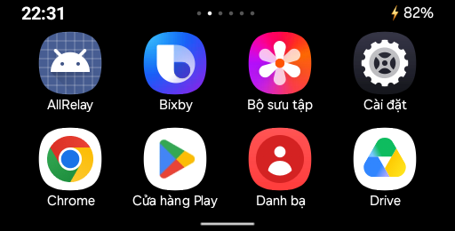

# Cover OS

A root-powered cover-screen launcher for the Samsung Galaxy Z Flip3. The Android app is named **Cover Launcher**; it is not a replacement Android ROM.

Use the 512 × 260 cover display to launch apps, navigate with gestures, read notifications, and approve a native ADB authorization request without unfolding the phone.



*Actual cover-display screenshot. Swipe left from the clock page to reach the app grid.*

## Features

- **Clock and notifications:** page 0 shows the clock, date, and three recent notifications. Tap a notification to open its app.
- **App grid:** 4 × 2 icons per page. Tap to launch on the cover; long-press to pin or unpin an app. Pinned apps appear first with amber labels.
- **Navigation:** swipe inward from either side for Back; swipe upward from the bottom handle for Home. Home returns to the clock page.
- **Close all:** force-stops apps with activities on the cover, excluding the launcher and SystemUI. Apps running only on the main screen are untouched.
- **Native ADB confirmation:** while folded, routes the existing SystemUI USB-debugging authorization task to the physical cover display. The real fingerprint, Always Allow checkbox, Allow and Cancel buttons are preserved. No key is authorized automatically.
- **Automatic recovery:** an independent root watchdog brings back a stopped or unhealthy service, including after app force-stop or a frozen process. A pending ADB confirmation takes priority over the launcher.
- **Experimental call assist:** moves matching `incall|voip|videocall` activities from the main display to the cover. Camera switching depends on Vietnamese Messenger labels; Samsung's native call UI is left to Samsung. This is not a general guarantee of calling-app compatibility.

## Requirements

- **Tested device:** rooted Galaxy Z Flip3, SM_F711B, Android 15; physical cover display 512 × 260. Other models and firmware are unverified.
- **Root:** Magisk with root access granted to `dev.vmn.coverlauncher`. The independent watchdog uses Magisk's `/data/adb/service.d` boot hook.
- **Host tools:** Bash, JDK 17 or newer, Android SDK Platform Tools (`adb`), and `zip`.
- **SDK packages:** Android platform 36 and Build Tools 36.0.0. The APK targets Android 15 (API 35) and has minimum API 31.
- **ADB:** a working authorized USB or Wi-Fi connection for initial installation.

The app requires overlay, notification, and notification-listener access. `install.sh` grants these and adds the package to the battery-optimization allowlist. Notification access lets the clock page display notification contents; root lets the app navigate, manage cover tasks, and force-stop cover apps.

## Build and install

```sh
git clone https://github.com/ChiThang-50Cent/cover-os.git
cd cover-os

# Omit this if your SDK is already at ~/android-sdk.
export ANDROID_HOME=/path/to/android-sdk

./build.sh
adb devices
ANDROID_SERIAL=<device-serial-or-ip:port> ./install.sh
```

No Gradle or third-party app dependencies are needed. The APK is written to `build/CoverLauncher.apk`, signed with a local debug keystore generated by the build script. Build outputs and that keystore are not versioned. Preserve your local keystore if you want future builds to update an existing installation without uninstalling it.

Grant **Cover Launcher** root access in Magisk. The installer also prints a root-shell policy command if a popup is unavailable. Open the **Cover Launcher** icon to bring up the launcher manually; swipe left on the clock page for apps.

`install.sh` installs both the APK and executable `/data/adb/service.d/cover-launcher.sh`. Installing the APK alone does **not** install the independent watchdog. Re-running the installer replaces the watchdog and starts a single instance.

## Recovery and operation

The watchdog runs outside the app process. It checks every 5 seconds and recovers an absent process or a missing/stale heartbeat. Heartbeats are stale after 30 seconds; service starts have a 30-second startup/retry grace period to avoid rapid crash loops.

The app publishes health only while its main loop, worker and root shell respond and its event-watcher process is alive. Recovery terminates only this app's process and explicitly starts `CoverService`. Android's `START_STICKY` and the boot receiver provide additional recovery paths.

At boot, the watchdog waits for `sys.boot_completed=1` and user 0's credential storage to become `RUNNING_UNLOCKED`. The tested phone has no PIN/pattern. If a secure lock is configured, its first unlock is still required; the app never bypasses it. A swipe-only cover keyguard is dismissed while folded and awake.

Inspect health through an authorized ADB connection:

```sh
adb shell "su -c '/data/adb/service.d/cover-launcher.sh --status'"
adb shell "su -c 'cat /data/adb/cover-launcher/watchdog.log'"
```

Force-stop is **not** a persistent stop switch. To disable automatic recovery deliberately:

```sh
adb shell "su -c '/data/adb/service.d/cover-launcher.sh --stop; chmod 600 /data/adb/service.d/cover-launcher.sh'"
```

This stops the watchdog and disables its next boot invocation; it does not stop the currently running app. Re-run `install.sh` to re-enable recovery. Before uninstalling, disable the watchdog so it does not keep attempting to restart an absent package.

## Verification

Real-device E2E checks were run on the rooted SM_F711B with Android 15, folded, over Wi-Fi ADB, including an independent final verification:

| Scenario | Observed result |
|---|---|
| Fresh ADB key, native Allow | Confirmation automatically appeared on the cover with the matching fingerprint and Always Allow unchecked; transport became `device` and a real shell returned `uid=2000`. |
| Fresh ADB key, native Cancel | Shell authorization was denied. Existing ADB access and the persistent trusted-key file were preserved. |
| App killed during pending authorization | App recovered; the same native prompt remained interactive and Allow still authorized the new host. |
| Frozen process (`SIGSTOP`) | Fresh process, heartbeat and foreground service recovered automatically. |
| App force-stop | App and foreground service recovered without manually starting them. |
| UI after recovery | Clock page, grid swipe, Gallery launch on the cover, and bottom Home gesture worked. |
| Repeated watchdog invocation | Exactly one daemon remained. |
| Reboot | Confirmed working by the device owner on the phone without a PIN/pattern. |

PIN-locked boot, other devices/firmware, and long-duration soak testing have not been verified. Reboot confirmation comes from the device owner, not an assistant-run reboot test.

## Implementation

| Component | Responsibility |
|---|---|
| `LauncherActivity` | Clock/notification page, pinned app grid, and cover-display app launches. |
| `CoverService` | Foreground service, gesture host, root logcat event watcher, 5-second state reconciliation and health heartbeat. |
| `UsbDebugging` | Finds live native confirmation activities, moves safe standalone tasks, and restores existing-task focus without recreating the authorization Intent. |
| `EdgeGestures` | Cover overlay strips; root Back and Home navigation. |
| `Root` | Persistent on-device `su` shell. |
| `root-watchdog.sh` | Independent watchdog, singleton lock, bounded service-start commands, heartbeat checks and Magisk boot hook. |
| `BootReceiver` | Service startup after boot and package replacement. |

The physical cover can be hidden from `DisplayManager` and `cmd display get-displays`. Its logical ID is selected from base records in root `dumpsys display`: the smallest non-default **internal** display. Virtual displays such as scrcpy are excluded.

## Limitations

- Only the native USB-debugging confirmation is routed, not every system dialog. Already-on-cover confirmations are preserved, including those nested in Samsung HOME. Main-display HOME or mixed-activity stacks are not moved because they contain unrelated activities.
- Samsung Settings and sensitive native dialogs can hide app overlays; gesture strips are unavailable while hidden. Use the native confirmation buttons for ADB authorization.
- Gesture strips occupy the outer 20 px on each side and 16 px at the bottom, consuming touches in those regions.
- Recovery requires a running watchdog, granted root access, an installed APK and a functioning Android system. It cannot repair revoked root access or recover a watchdog that has itself been killed; restart it or reboot.
- Recovery while the CPU is suspended can proceed only after the device wakes.
- Automatic recovery and a boot hook do not guarantee that Wi-Fi ADB itself stays enabled or keeps the same endpoint after reboot.

## License

[MIT](LICENSE).
